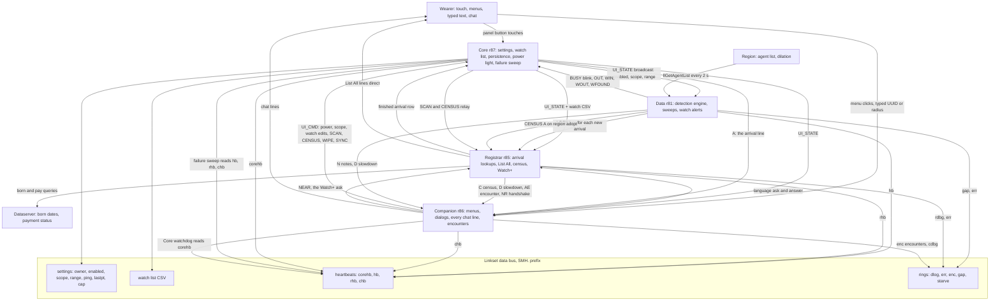
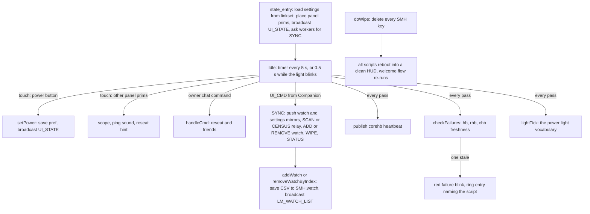
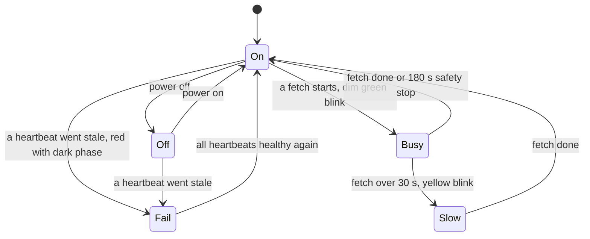
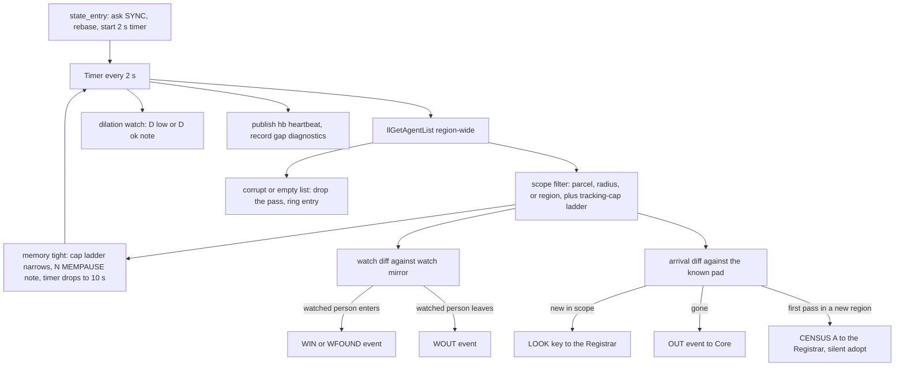
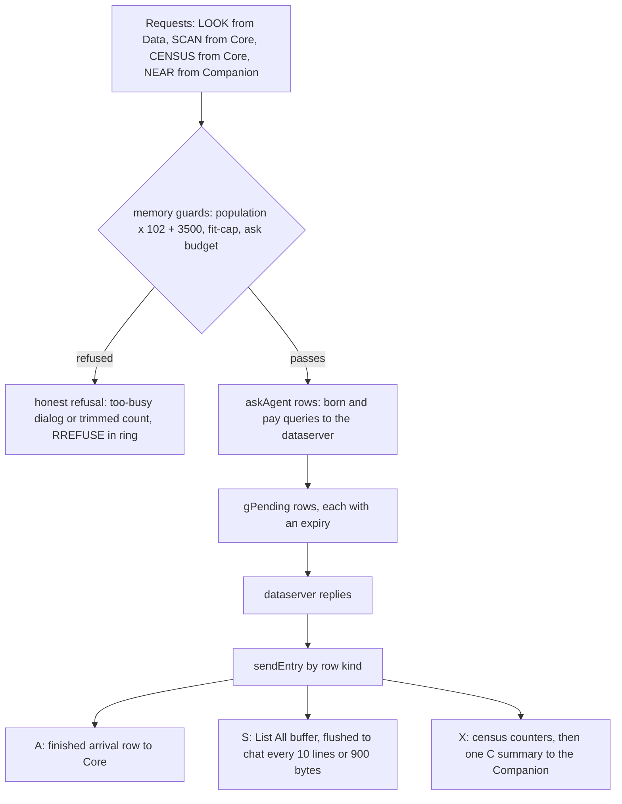
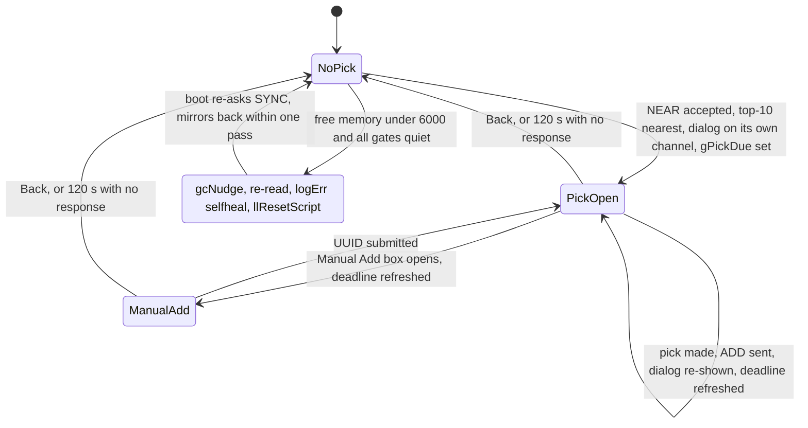
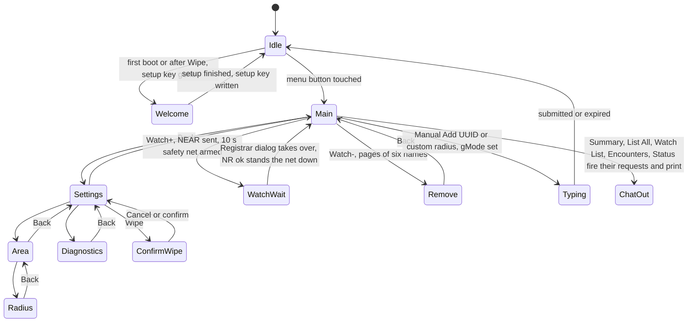
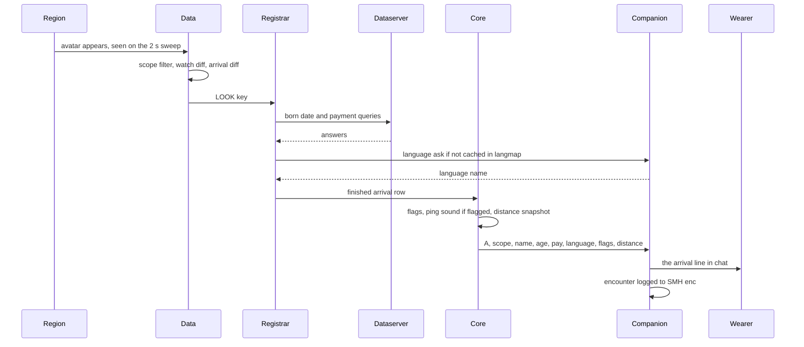

# Opossum Labs Awareness HUD - Script Architecture

Four scripts, one logical object. Each script lives in the LSL `default` state only, so the "states" below are conceptual: each script is a set of event handlers (timer, listen, touch, link_message, dataserver) sharing globals, plus a shared memory bus. Everything durable lives in linkset data under the `SMH.*` prefix, so any script can reset without losing settings, the watch list, logs, or encounters.

Current rounds: Core 87 (build 111126087), Data 81 (110226081), Registrar 85 (110626085), Companion 86 (110626086).

## The Big Picture

The Core holds configuration and drives the power light. The Data Script is the detection engine. The Registrar does every account-data fetch (the memory-heavy work) and all listings. The Companion is the only script that talks to the wearer: menus, dialogs, and every chat line.

The two safety loops worth calling out:

- Core sweeps the three worker heartbeats (`hb`, `rhb`, `chb`); a stale one fails the power light to a red blink and writes a failure ring entry.
- The Companion watches Core the same way (`corehb`, stale after 120 seconds) because a dead Core cannot report itself. Whoever notices, the wearer sees the light.

## Core Script (r87) - settings, watch list, power light

The Core owns every preference and the watch list, persists all of it to linkset data, and relays menu commands to the right worker. It never talks to the dataserver.

The power light is a genuine state machine with a fixed priority: failure beats OFF, OFF beats busy.

Reseat recovery: `lastpt` records the panel position; a Status Check compares it and prints the reseat hint when prims drifted, and the reseat command rebuilds the default placement.

## Data Script (r81) - the detection engine

One timer, one sweep loop, no dataserver. Every 2 seconds it fetches the region agent list, filters it to scope, and diffs it against what it already knows. It degrades honestly: a memory-guard ladder narrows the tracking cap in busy regions instead of crashing.

Everything above flows out as events and notes; the Registrar does the actual account lookups, so a slow dataserver never stalls detection.

## Registrar Script (r85) - lookups, listings, census, Watch+

The fourth script exists for one reason: listing memory. Every dataserver pipeline lives here against a nearly empty 64 KB Mono budget, so a listing collision can no longer kill detection. All four of its request kinds share one row pipeline with memory guards priced against live population.

List All runs in capped waves so the heap never holds the whole region at once. The census counts new accounts, scripted agents, and watched people in one summary line, with born-date asks budgeted against free memory.

The Watch+ picker got the round-85 fix: its state is the one thing that could wedge the self-heal, so it now expires.

Self-heal gates: no scan wave (`gScanCount`), no census (`gCensusLeft`), no buffered listing lines (`gScanLines`), no pick dialog (`gPickKeys`), no pending rows (`gPending`). The pick expiry is what reopens the last gate after a dismissed dialog.

## Companion Script (r86) - menus, dialogs, the text valve

Every word the wearer reads comes from here, including the system notes whose full text is far too big to keep in the workers. It owns the menu tree, the welcome flow, the encounter log, and the self-heals.

Alongside the menu tree, the timer runs three standing jobs:

- Core watchdog: `corehb` over 120 seconds stale means Core is dead or hung, so the Companion takes the power light and blinks red itself, with a `corewatch` ring entry.
- Low-water self-report: under a free-memory threshold it says so, throttled to once per 10 minutes.
- Self-heal: under 2,000 free at a quiescent moment (no typed-input mode, no pending Watch+ safety net, no welcome flow active or scheduled, no live Core watchdog) it writes a `selfheal` ring entry and resets itself.

The text valve decodes worker codes into owner chat: `A` arrivals, `L` departures, `W` watch in/out, `AE` scripted-agent encounters, `C` census summaries, `D` region slowdown, `N` system notes, `NR` the Watch+ handshake.

## One Arrival, End To End

The busiest path in the HUD: a stranger walks into scope.

Variations on this path: a watched arrival also fires a `WFOUND` or `WIN` event with the alert ping; the first arrival in a new region also triggers the adopt census, which comes back as the one-line ARRIVAL SUMMARY; a scripted agent is named in an `AE` encounter; and a sim running slow adds the short `D` slowdown line.

## Reference: The Bus

Link messages (all scripts, `LINK_SET` broadcast, each script matches only its own literals):

| Channel | Who sends | Carries |
|---|---|---|
| LM_UI_CMD 19030 | Companion to Core | menu actions: SYNC, SCAN, CENSUS, ADD, REMOVE, WIPE, STATUS |
| LM_UI_STATE 19029 | Core to all | enabled, scope, range mirror |
| LM_WATCH_LIST 19031 | Core to all | watch list CSV mirror |
| LM_SWEEP_ASK 19034 | mixed | NEAR from Companion, SCAN and CENSUS relay from Core, LOOK and CENSUS A from Data; Data itself answers REBASE only |
| LM_SAY 19027 | workers to Companion | text-valve codes: A, L, W, AE, C, D, N, NR |
| LM_EVENT 19035 | Data to Core, Companion | OUT, BUSY, WIN, WOUT, WFOUND |
| LM_LANG_ASK / TELL 19024 / 19025 | Registrar to Companion and back | viewer language code to display name |
| LM_DATA_ASK / TELL 19032 / 19033 | Core to Data and back | ping handshake |
| LM_MEM_ASK / TELL 19036 / 19037 | any script | Debug line: name, free bytes, build |

Linkset data keys (`SMH.*`), the only durable state:

| Key | Owner | Holds |
|---|---|---|
| owner, enabled, scope, range, ping | Core | settings, written on every change |
| watch | Core | watch list CSV |
| lastpt | Core | panel position for the reseat hint |
| setup | Companion | welcome done marker, deleted by Wipe |
| cap | Data | tracking cap, read for busy-context lines |
| corehb, hb, rhb, chb | each script | liveness heartbeats, the failure sweep and watchdog read them |
| gap, coregap, starve | Core, Data | freeze and starvation diagnostics |
| dlog, cdbg, rdbg, dbg | each script | debug ring entries |
| err0 to err9, errNext | Data and Registrar | error ring, ten slots |
| enc, encdays | Companion | encounter log and retention |
| langmap | Registrar | cached viewer language codes |

<!-- ARCHITECTURE.md mirrors the awareness-hud-architecture canvas. Update this file when script rounds or flows change. -->
